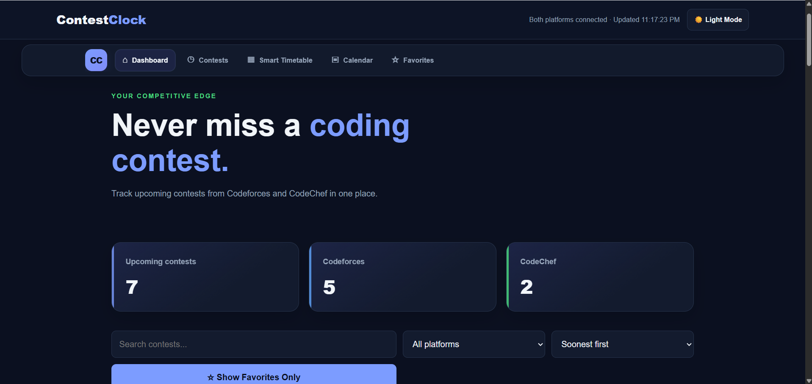
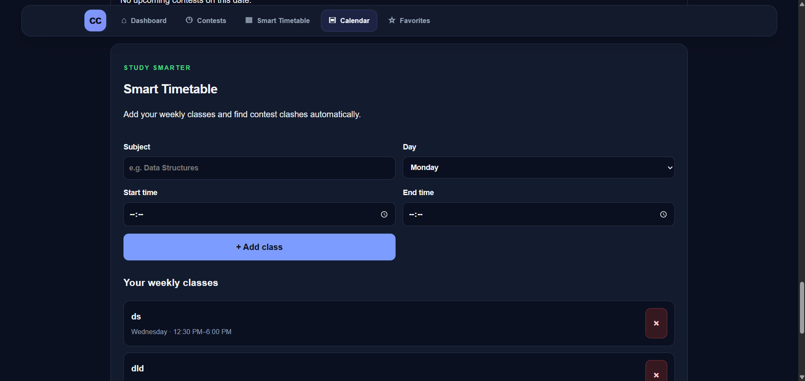
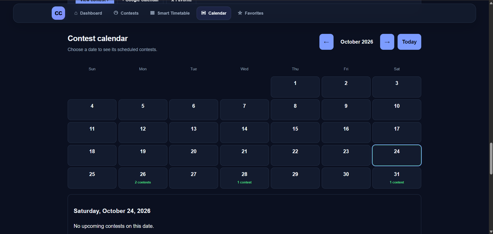
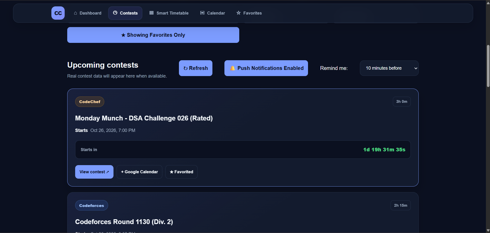

# ⏰ ContestClock

**Never miss a competitive programming contest.**

ContestClock is a web application that brings upcoming programming contests from Codeforces and CodeChef into one place. It helps students track contest schedules, save interesting contests, receive reminders, and plan their practice around their college timetable.

🌐 **Live Demo:** https://contestclock.onrender.com  
💻 **GitHub Repository:** https://github.com/varshith162008/ContestClock

## 📸 Screenshots

<!-- Save your actual screenshots in docs/screenshots before committing. -->

### Dashboard


### Smart Timetable


### Calendar


### Favorites


## ✨ Features

- **Upcoming contests:** View upcoming Codeforces and CodeChef contests in one dashboard.
- **Countdowns:** Track how soon a contest begins.
- **Search and filters:** Find contests using search, platform, and available sorting or filtering options.
- **Push notifications:** Subscribe to browser push notifications and test delivery.
- **Configurable reminders:** Select a supported reminder interval.
- **Favorites:** Save contests for quick access.
- **Smart Timetable:** Organize your schedule and identify potential contest clashes.
- **Calendar view:** Browse contest dates in a monthly calendar.
- **Google Calendar:** Open contest events through Google Calendar links.
- **Authentication:** Register and log in to access the application's account features.
- **Dark interface:** Use a dark-themed dashboard designed for comfortable browsing.

## 🛠️ Tech Stack

- HTML, CSS, JavaScript
- Node.js
- Express.js
- Web Push API and VAPID
- Supabase for the configured authentication and data features
- Codeforces and CodeChef contest APIs
- Render for deployment

## 🚀 Run Locally

### Prerequisites

Install a supported version of Node.js and npm.

### 1. Clone the repository

```bash
git clone https://github.com/varshith162008/ContestClock.git
cd ContestClock
```

### 2. Install dependencies

```bash
npm install
```

### 3. Configure environment variables

Create a local `.env` file using the variable names required by the project. Configure the required VAPID keys and any Supabase credentials used by your setup.

**Never commit `.env` or expose secret keys in screenshots, logs, or public documentation.**

### 4. Start the server

```bash
node server.js
```

Open `http://localhost:3000` in your browser, unless your local configuration uses a different port.

## 🔔 Notifications

ContestClock uses browser push subscriptions and a Node.js backend to send push notifications. Notification delivery depends on browser permission, subscription validity, backend availability, and deployment behavior.

The live test endpoint is intended for testing the configured notification system; it is not a substitute for verifying scheduled reminder delivery.

## 🧪 Testing

The following features have been manually tested on the deployed website:

- Website and contest data loading
- Login and registration
- Favorites and timetable persistence after refresh
- Search and contest filters
- Reminder interval updates
- Browser subscription and test push notification delivery

Automatic reminder reliability across server sleep, restarts, and deployment filesystem changes still requires separate verification.

## ⚠️ Deployment Notes

The current backend uses local JSON files for some settings, subscriptions, and sent-reminder records. On hosting platforms with ephemeral filesystems, these records may not persist through restarts or redeployments. Free hosting may also suspend an idle service.

Treat scheduled reminder delivery as a feature that needs continued reliability testing.

## 🎯 Project Goal

ContestClock was created to make competitive programming contest tracking easier for students by combining contest discovery, reminders, favorites, calendar access, and timetable planning in one application.

## 👨‍💻 Author

**Varshith Sai Badam**

Built as a personal project to practise web development, API integration, authentication, push notifications, and deployment.

---

If you find the project useful, consider giving the repository a ⭐ on GitHub.